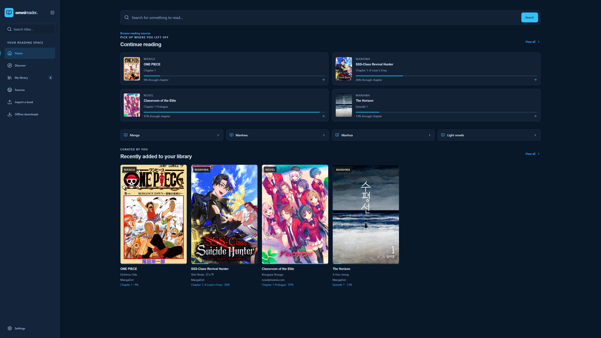
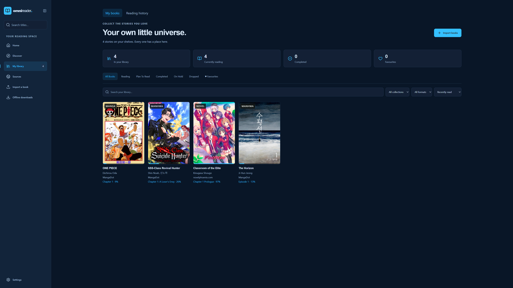
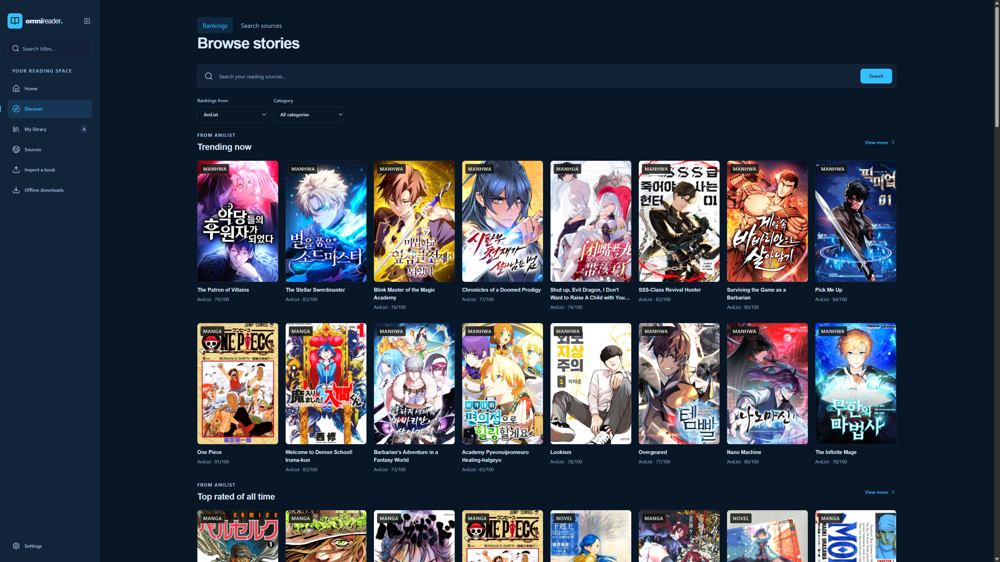

# OmniReader

**Manga, manhwa, manhua and novels. One library.**

A reader that runs on your Windows PC and opens in your browser.
Pick up where you left off, discover something new, or bring your own books.

**[Download for Windows](https://github.com/TheProPizza/OmniReader/releases/latest)** · [All releases](https://github.com/TheProPizza/OmniReader/releases) · [Getting started](#getting-started) · [Screenshots](#screenshots)

No OmniReader account required. Your library stays on your PC.

## Screenshots

**Home** — Continue reading and see recent additions to your library.

<strong>Library</strong> — Your books, reading status and favourites

Organise your collection, filter your shelves and find your next chapter.

<strong>Discover</strong> — Rankings and reading-source search

Browse MangaBaka, AniList or MyAnimeList rankings, or search your enabled sources.

## What you can do

| | |
| --- | --- |
| **Read comics and novels** | Manga, manhwa, manhua and light novels, with adjustable reading modes and typography. |
| **Find your next read** | Browse rankings, expand recommendation shelves and search supported reading sources. |
| **Keep your place** | Reading progress, bookmarks, favourites and history in one local library. |
| **Bring your own books** | Import EPUB, CBZ, CBR, PDF, text, HTML and Markdown files. |
| **Read on another device** | Optional home-network access or email-protected remote access from a phone or tablet. |
| **Connect AniList** | Match library titles and sync supported reading progress. |
| **Save for offline reading** | Download chapters from sources that permit it. |

Source availability depends on third-party websites and extensions. Manage comic sources and LNReader novel extensions in **Sources**.

## Getting started

1. **[Download the Windows ZIP](https://github.com/TheProPizza/OmniReader/releases/latest)** and extract the whole archive to a folder you want to keep.
2. Open **Start OmniReader**. The first launch prepares the reading engines and sources, so keep your internet connection on. You do not need to install Node.js or Java yourself.
3. Start reading in your browser. Use **Stop OmniReader** when you want to shut it down.

> **Download the release ZIP:** GitHub's **Code → Download ZIP** contains the source code, rather than the Windows package.

## Read on your phone

Open **Settings → Phone Access** on your PC and choose an access method:

| Access | How it works |
| --- | --- |
| **Local Access** | Connect on the same trusted home network using the link or QR code. If Windows asks for firewall access, allow **Private networks only**. |
| **Remote Access** | Use a Cloudflare Quick Tunnel protected by email verification. Add approved email addresses and open the current HTTPS link or QR code. |

**Your PC must stay on and OmniReader must be running.** Both access methods are off by default. Remote links are temporary and can change after a tunnel restart. Do not forward OmniReader's port on your router.

## Updates and your library

On your Windows host PC, go to **Settings → Application updates → Check for updates → Download & install**. OmniReader verifies the Windows ZIP before installation and refreshes the current tab when the updated app is ready. Phone browsers cannot install updates.

For a manual upgrade, stop OmniReader and replace the application files using the new Windows ZIP.

> **Keep your entire `data/` folder and any `.env` file.** They contain your library, downloads, reading progress and configuration. Do not replace them with a fresh installation.

Stable Windows packages are published on the [public releases page](https://github.com/TheProPizza/OmniReader/releases). The updater checks those releases; drafts and prereleases are excluded. The public repository keeps its five newest published releases.

## Need help?

- **The app will not start:** check `data/launcher.log`.
- **Comic sources are not working:** open **Sources** and use the restart or startup-report options.
- **One source will not load:** the website or extension may be unavailable; try another supported source.

Developer documentation is available under `docs/` in the source repository.

---

Licensed under [MIT](LICENSE). Third-party components retain their respective licences.
