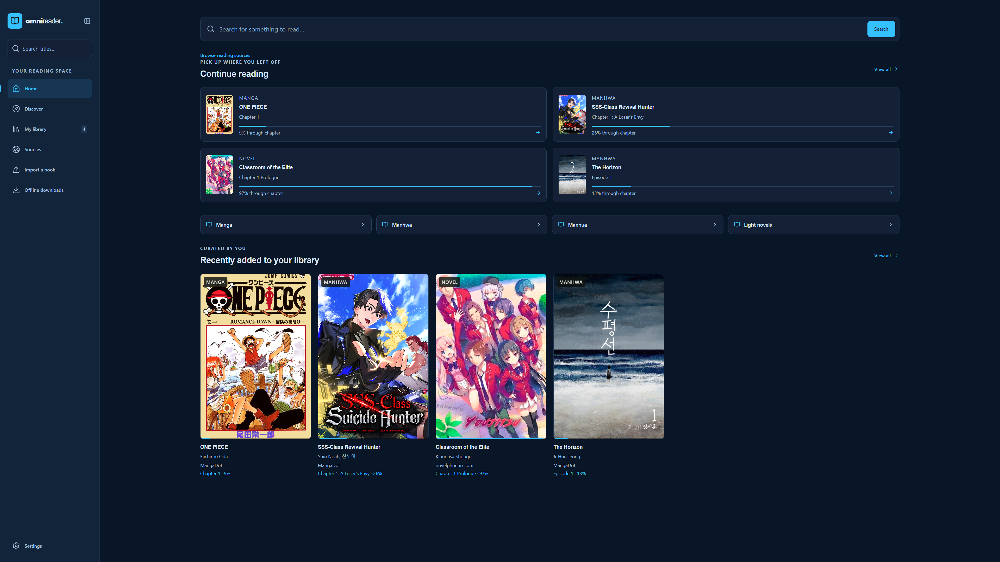
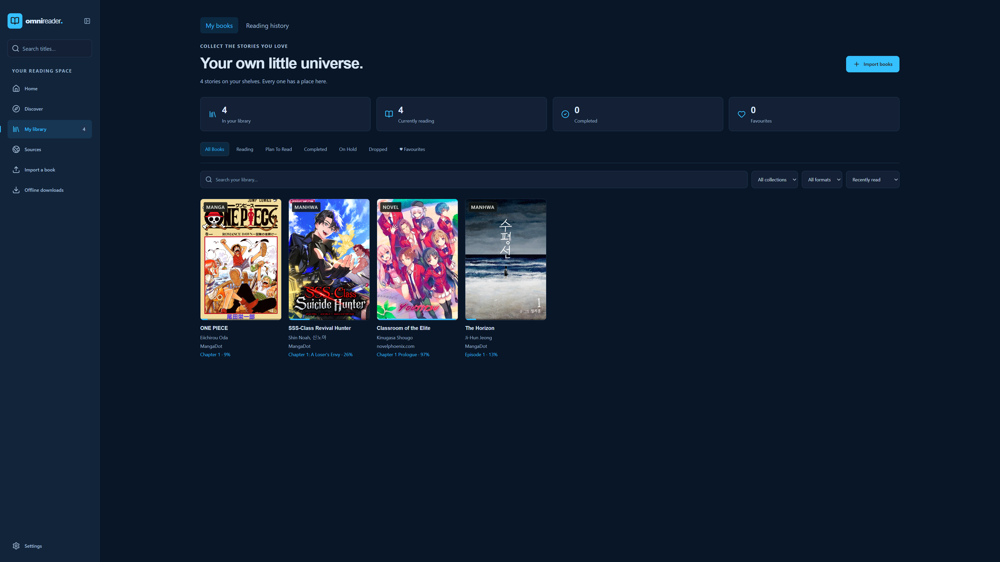
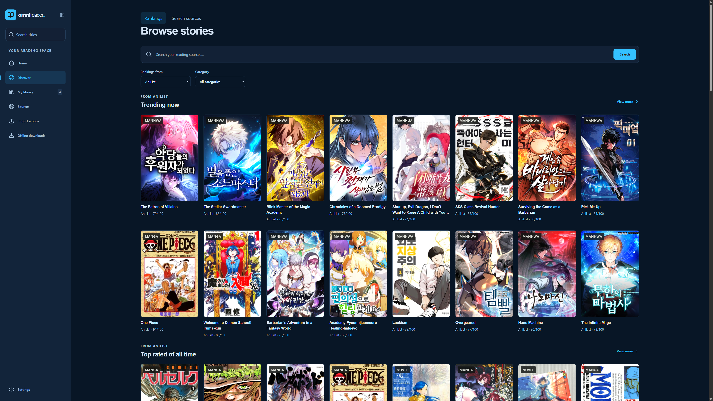

# OmniReader

**Manga, manhwa, manhua, light novels and books. One library.**

A reader that runs on your Windows PC and opens in your browser.
Pick up where you left off, discover something new, or bring your own books.

**[Download for Windows](https://github.com/TheProPizza/OmniReader/releases/latest)** · [All releases](https://github.com/TheProPizza/OmniReader/releases) · [Getting started](#getting-started) · [Screenshots](#screenshots) · [Changelog](https://github.com/TheProPizza/OmniReader/blob/main/CHANGELOG.md)

No OmniReader account required. Your library stays on your PC.

## Screenshots

**Home** — Continue reading and see recent additions to your library.

<strong>Library</strong> — Your books, reading status and favourites

Organise your collection, filter your shelves and find your next chapter.

<strong>Discover</strong> — Rankings and reading-source search

Browse MangaBaka, AniList or MyAnimeList rankings, or search your enabled sources.

## What you can do

| | |
| --- | --- |
| **Read comics and novels** | Manga, manhwa, manhua and light novels, with adjustable reading modes and typography. |
| **Find your next read** | Browse rankings and genres such as Isekai, High Fantasy and Sci-Fi, or search supported reading sources. |
| **Explore from Home** | Suggested now, popular picks, top-rated titles and comic/novel categories alongside your reading activity. |
| **Keep reading through source errors** | Comic chapters automatically try the next working source when the same chapter can be matched. |
| **Keep your place** | Reading progress, bookmarks, favourites and history in one local library. |
| **Bring your own books** | Import EPUB, CBZ, CBR, PDF, text, HTML and Markdown files. |
| **Discover ordinary books** | A Books section with Open Library, Google Books and Hardcover metadata, reading lists and series groups. |
| **Acquire authorised copies** | Search native book sources, follow downloads and import completed EPUB/PDF files inside OmniReader. |
| **Read EPUB and PDF** | EPUB typography and themes; PDF zoom, page navigation and bookmarks. Resume reading between OmniReader devices. |
| **Send to your e-reader** | Email compatible EPUBs to Kindle or upload EPUB/PDF files to a linked Kobo cloud folder through Google Drive or Dropbox. Requires configuration and a compatible device. |
| **Read on another device** | Optional home-network access from a phone or tablet. |
| **Connect AniList** | Match library titles and sync supported reading progress. |
| **Save for offline reading** | Download chapters from sources that permit it. |
| **Make it yours** | Liquid Glass is the default interface, with a Classic option in Settings. Both work with every colour theme; title pages show background artwork when available. |

AniList’s first connection needs a public application Client ID. The PC owner can set this up once from **Settings → AniList sync → Connect to AniList**, without editing server files or entering a client secret.

Source availability depends on third-party websites and extensions. Manage comic sources and LNReader novel extensions in **Sources**.

For ordinary books, open **Books**, then import an EPUB/PDF or discover a title to add to your reading list. Configure optional metadata providers, native book sources and e-reader delivery in **Settings → Books & e-readers** on your PC. Open Library works without a key. Book sources run inside OmniReader without another application. Public sources need no key; optional source memberships and TorBox need your own credentials. Source availability varies. Cloud delivery requires your own Google/Dropbox OAuth app, and Kindle requires an approved sender and SMTP account. Kindle/Kobo reading positions remain separate from OmniReader's device sync.

## Getting started

1. **[Download the Windows ZIP](https://github.com/TheProPizza/OmniReader/releases/latest)** and extract the whole archive to a folder you want to keep.
2. Open **Start OmniReader**. The first launch prepares the reading engines and sources, so keep your internet connection on. You do not need to install Node.js or Java yourself.
3. Start reading in your browser. Use **Stop OmniReader** when you want to shut it down.

> **Download the release ZIP:** GitHub's **Code → Download ZIP** contains the source code, rather than the Windows package.

## Read on your phone

Open **Settings → Phone Access** on your PC and enable **Local Access**. Connect your phone or tablet to the same trusted home network, then open the link or scan the QR code. If Windows asks for firewall access, allow **Private networks only**.

**Your PC must stay on and OmniReader must be running.** Local Access is off by default. Any device on that network can access your library while it is enabled. Do not forward OmniReader's port on your router.

## Updates and your library

On your Windows host PC, go to **Settings → Application updates → Check for updates → Download & install**. OmniReader verifies the Windows ZIP before installation and refreshes the current tab when the updated app is ready. Phone browsers cannot install updates.

For a manual upgrade, stop OmniReader and replace the application files using the new Windows ZIP.

> **Keep your entire `data/` folder and any `.env` file.** They contain your library, downloads, reading progress and configuration. Do not replace them with a fresh installation.

Stable Windows packages are published on the [public releases page](https://github.com/TheProPizza/OmniReader/releases). The updater checks those releases; drafts and prereleases are excluded. The public repository keeps its five newest published releases.

## Need help?

- **The app will not start:** check `data/launcher.log`.
- **Comic sources are not working:** open **Sources** and use the restart or startup-report options.
- **One source will not load:** the website or extension may be unavailable; try another supported source.

Developer documentation is available under `docs/` in the source repository.

---

Licensed under [MIT](LICENSE). Third-party components retain their respective licences.
